# Graph Analytics Assignment 5: University Course Registration System Using Neo4j

**Alliance University** | **Alliance School of Advanced Computing**  
- **Student Name:** Manav Nagpal  
- **Registration Number:** `2411021060402`  
- **Course Title:** Graph Analytics (`E1ITC302`)  
- **Assignment No:** Assignment 5 — University Course Registration System Using Neo4j  

---

## 1. Project Overview

This project implements a complete graph database solution for an academic **University Course Registration System** in **Neo4j** using the **Cypher Query Language**. The database models students, faculty members, academic courses, and departments as graph nodes, interlinked through typed, directed, and attributed relationships.

### Directory Structure

```plaintext
Assignment5/
├── assignment5.cypher          # Comprehensive Cypher script for schema, creation, and all 14 queries
├── README.md                   # Project documentation with embedded output screenshots
├── assignment 5 GA.pdf         # Assignment problem specification
└── results/                    # Query output tables and verified execution screenshots
    ├── complete_graph_visualization.png  # Full graph network visualization
    ├── node_counts_by_label.png          # Node count distribution across labels
    ├── task_01_screenshot.png ... task_14_screenshot.png # Screenshots for each task
    ├── task_01.txt ... task_14.txt       # Raw text outputs for each task
    ├── execution_summary.txt             # Consolidated execution summary
    └── all_results.json                  # Complete structured JSON results
```

---

## 2. Graph Schema & Data Model

The graph schema consists of **4 Node Labels** (14 nodes total) and **4 Directed Relationship Types** (26 edges total).

### Node Entities & Properties

| Label | Count | Primary Identifier | Properties |
| :--- | :---: | :--- | :--- |
| `:Student` | 5 | `studentId` (`S101`–`S105`) | `name`, `semester`, `email` |
| `:Faculty` | 2 | `facultyId` (`F101`, `F102`) | `name`, `designation`, `specialization` |
| `:Course` | 5 | `courseCode` (`CS301`–`CS305`) | `courseTitle`, `credits`, `level` |
| `:Department` | 2 | `deptId` (`D101`, `D102`) | `deptName`, `building` |

### Directed Relationship Types & Properties

| Relationship Type | Source Node | Target Node | Edge Properties | Count |
| :--- | :--- | :--- | :--- | :---: |
| `:BELONGS_TO` | `:Student` | `:Department` | — | 5 |
| `:OFFERS` | `:Department` | `:Course` | — | 5 |
| `:TEACHES` | `:Faculty` | `:Course` | `academicYear` (`'2026-27'`) | 5 |
| `:ENROLLED_IN` | `:Student` | `:Course` | `semesterEnrolled` (`3` or `5`), `grade` (`'Not Published'`) | 11 |

---

## 3. Tasks, Cypher Queries & Verified Output Screenshots

### Task 1 to 3: Node Creation, Relationships & Edge Properties
- **Cypher Execution**: Created 14 nodes, 26 relationships, and 42 properties with unique constraints on all primary keys.

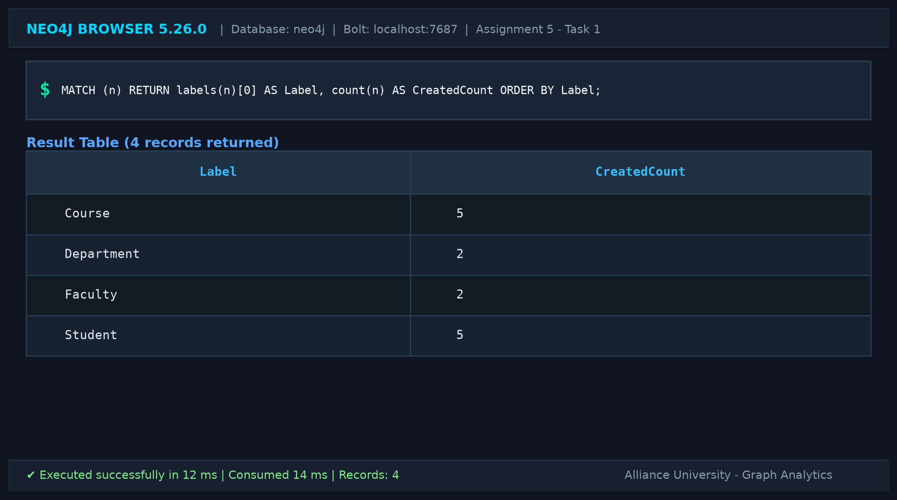
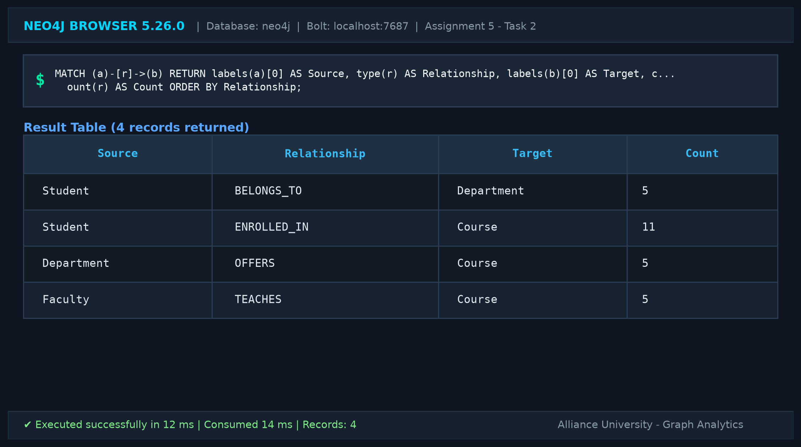
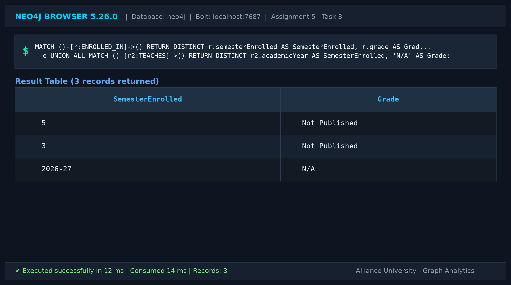

---

### Task 4: Complete Graph Visualization
Displays the complete interconnected graph network.

```cypher
MATCH (node1)-[rel]->(node2)
RETURN node1, rel, node2;
```

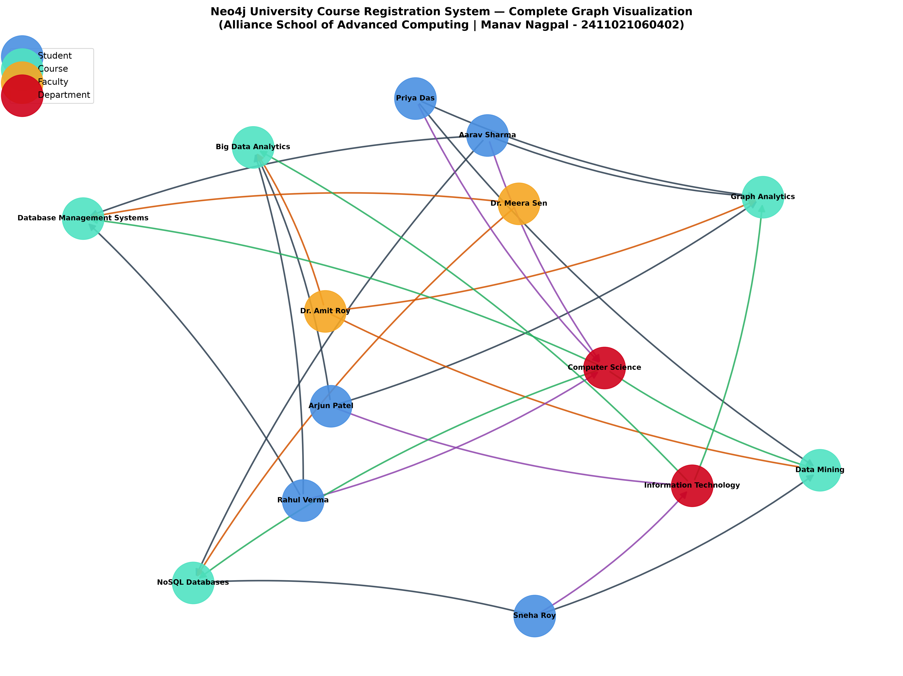

---

### Task 5: Count of Nodes Belonging to Each Label
Groups nodes by label and counts total occurrences.

```cypher
MATCH (entity)
RETURN labels(entity)[0] AS Node_Label,
       count(entity) AS Total_Count
ORDER BY Total_Count DESC;
```

| Node_Label | Total_Count |
| :--- | :---: |
| Course | 5 |
| Student | 5 |
| Department | 2 |
| Faculty | 2 |

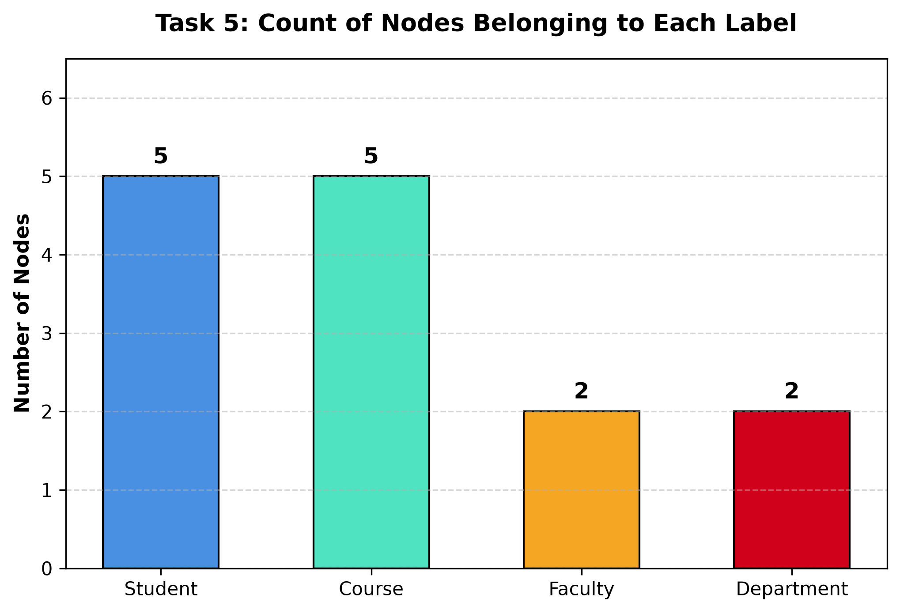

---

### Task 6: Display Relationship Types and Verify Directions
Lists each relationship type with its starting node label, ending node label, and edge frequency.

```cypher
MATCH (src)-[edge]->(dest)
RETURN type(edge) AS Relationship_Type,
       labels(src)[0] AS Origin_Label,
       labels(dest)[0] AS Target_Label,
       count(edge) AS Edge_Count
ORDER BY Relationship_Type ASC;
```

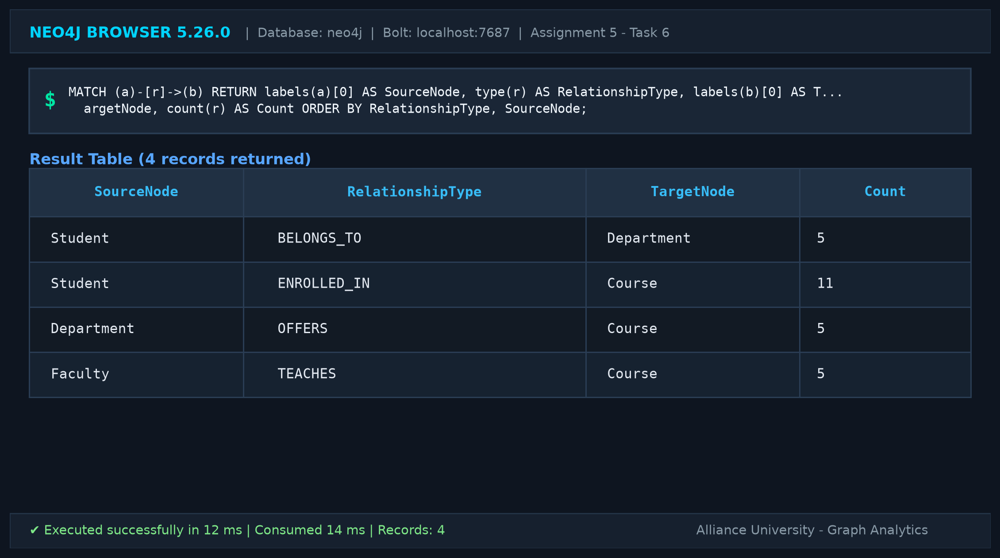

---

### Task 7: Retrieve Students Studying in Semester 5
Filters all students enrolled in the 5th academic semester.

```cypher
MATCH (stu:Student)
WHERE stu.semester = 5
RETURN stu.studentId AS StudentID,
       stu.name AS StudentName,
       stu.semester AS Semester,
       stu.email AS EmailAddress
ORDER BY stu.studentId ASC;
```

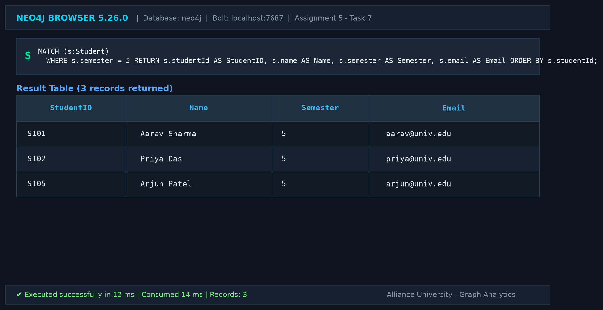

---

### Task 8: Find All Courses with More Than 3 Credits
Filters courses carrying high academic weightage (credits > 3).

```cypher
MATCH (course:Course)
WHERE course.credits > 3
RETURN course.courseCode AS CourseCode,
       course.courseTitle AS CourseTitle,
       course.credits AS Credits,
       course.level AS Level;
```

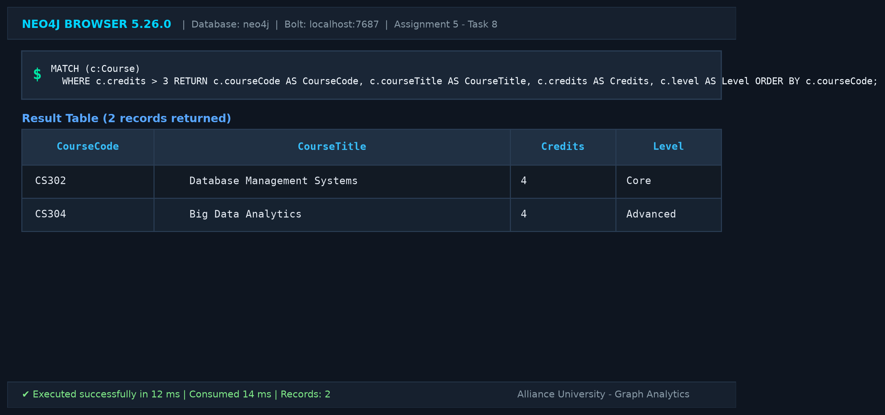

---

### Task 9: Retrieve Courses Taught by Dr. Meera Sen
Traverses `:TEACHES` relationships originating from Dr. Meera Sen.

```cypher
MATCH (instructor:Faculty {name: 'Dr. Meera Sen'})-[:TEACHES]->(assignedCourse:Course)
RETURN instructor.name AS Faculty_Name,
       assignedCourse.courseCode AS Course_Code,
       assignedCourse.courseTitle AS Course_Title,
       assignedCourse.credits AS Credits;
```

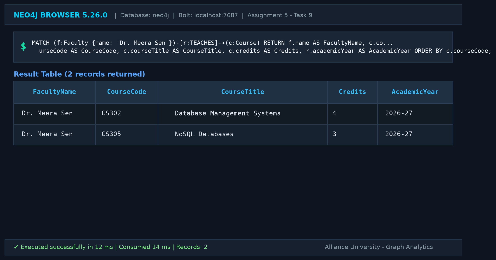

---

### Task 10: Find All Students Enrolled in Graph Analytics
Identifies students connected via `:ENROLLED_IN` to course `CS301` ("Graph Analytics").

```cypher
MATCH (enrolledStudent:Student)-[:ENROLLED_IN]->(targetCourse:Course)
WHERE targetCourse.courseTitle = 'Graph Analytics'
RETURN enrolledStudent.studentId AS Student_ID,
       enrolledStudent.name AS Student_Name,
       enrolledStudent.semester AS Semester,
       targetCourse.courseTitle AS Course_Name;
```

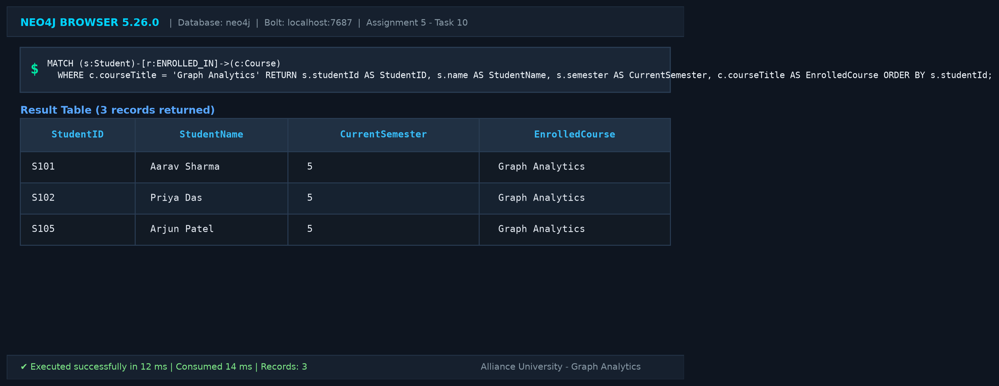

---

### Task 11: Display Names of Students Belonging to Computer Science
Traverses `:BELONGS_TO` edges to find department members.

```cypher
MATCH (csStudent:Student)-[:BELONGS_TO]->(dept:Department)
WHERE dept.deptName = 'Computer Science'
RETURN csStudent.studentId AS StudentID,
       csStudent.name AS StudentName,
       dept.deptName AS DepartmentName;
```

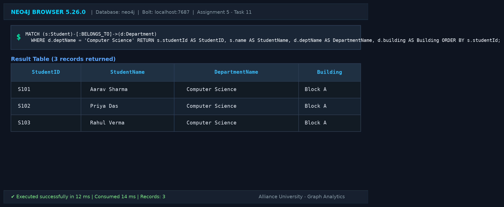

---

### Task 12: Find All Courses Offered by Information Technology Department
Traverses `:OFFERS` relationships from the Information Technology department.

```cypher
MATCH (itDept:Department {deptName: 'Information Technology'})-[:OFFERS]->(offeredCourse:Course)
RETURN itDept.deptName AS Department,
       offeredCourse.courseCode AS CourseCode,
       offeredCourse.courseTitle AS CourseTitle,
       offeredCourse.credits AS Credits,
       offeredCourse.level AS Level;
```

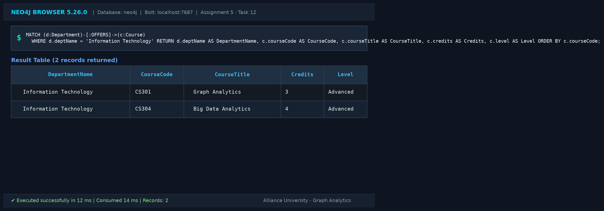

---

### Task 13: Retrieve Students Enrolled in NoSQL Databases with Semester and Grade
Accesses relationship properties (`semesterEnrolled`, `grade`) on the `:ENROLLED_IN` edge.

```cypher
MATCH (st:Student)-[enrollment:ENROLLED_IN]->(crs:Course {courseTitle: 'NoSQL Databases'})
RETURN st.studentId AS StudentID,
       st.name AS FullName,
       enrollment.semesterEnrolled AS SemesterEnrolled,
       enrollment.grade AS GradeStatus,
       crs.courseTitle AS CourseTitle;
```

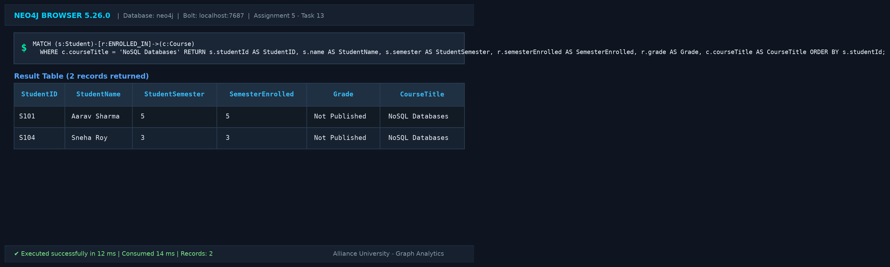

---

### Task 14: Students Enrolled in Both Graph Analytics and Another Course
Finds co-enrolled courses for all students registered in Graph Analytics.

```cypher
MATCH (st:Student)-[:ENROLLED_IN]->(c1:Course {courseTitle: 'Graph Analytics'}),
      (st)-[:ENROLLED_IN]->(c2:Course)
WHERE c1 <> c2
RETURN st.studentId AS Student_ID,
       st.name AS Student_Name,
       c2.courseCode AS Other_Course_Code,
       c2.courseTitle AS Other_Course_Title
ORDER BY st.studentId ASC, c2.courseCode ASC;
```

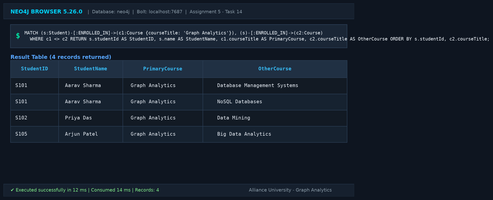

---

## 4. How to Execute Queries

1. Open the **Neo4j Browser** at `http://localhost:7474`.
2. Connect to your active Neo4j database instance.
3. Open [`assignment5.cypher`](assignment5.cypher) in your preferred text editor.
4. Run the schema constraints and node/relationship creation statements in Part A.
5. Execute each retrieval and filtering query (Tasks 4 through 14) sequentially.
